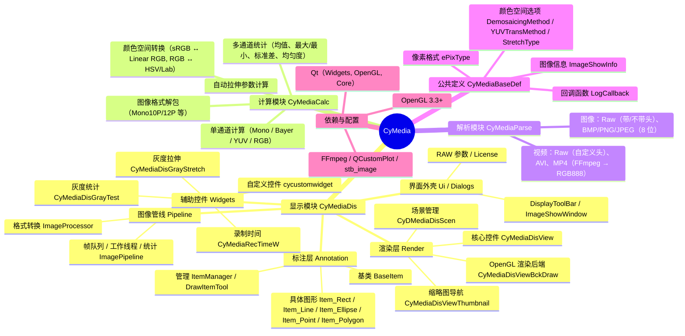

# CyMedia 图像/视频处理与显示库

> 文档入口：
> - 库级说明：[`CyMedia/README.md`](CyMedia/README.md)
> - 显示模块：[`CyMedia/src/View/README.md`](CyMedia/src/View/README.md)
> - 示例程序：[`CyMediaDisTest/README.md`](CyMediaDisTest/README.md)
> - 发布包：[`GenRelease.bat`](GenRelease.bat)

## 1. 概述
CyMedia 是一个基于 **Qt5.14.2** 和 **OpenGL** 的 C++ 库，主要用于：
- **高性能图像显示**（支持 Mono、Bayer、RGB、RGBA、多种 YUV 格式，8/16/31 位深度）
- **图像计算**（直方图统计、灰度拉伸、颜色空间转换、均匀度等）
- **交互式绘图**（点、线、矩形、椭圆、多边形等 ROI 标注）
- **图像文件解析/保存**：Raw（带/不带头）+ BMP、PNG、JPEG（8 位）
- **视频文件解析**：带自定义头的 Raw 视频、AVI、MP4（FFmpeg），输出 RGB888

内部采用 **双缓冲纹理**、**OpenGL 着色器** 实现高效渲染，并提供了灰度拉伸、颜色映射、Bayer 去马赛克、YUV 转换等图像增强功能，适用于**工业相机**、**医疗影像**、**科研采集**等场景。

### 1.1 当前目录结构

```text
CyMedia/
├── CyMedia/                 # 库工程（DLL）
│   ├── src/
│   │   ├── Calculate/       # 纯算法
│   │   ├── Parse/           # 文件/视频解析
│   │   ├── common/          # 公共定义 + 日志
│   │   └── View/            # 显示模块：Pipeline / Render / Annotation / Widgets / Ui / Dialogs
│   ├── resources/           # ICONS / GLSL / translate / colorMap
│   ├── 3rdparty/            # FFmpeg / QCustomPlot / stb_image
│   ├── CyMedia.vcxproj
│   └── CMakeLists.txt
├── CyMediaDisTest/          # 示例/冒烟测试程序
├── OutFile/                 # 构建输出（已忽略）
├── CMakeLists.txt           # CMake 顶层入口
├── GenRelease.bat           # 发布包生成
└── README.md
```

`View` 的内部结构、数据流和线程模型见 [`CyMedia/src/View/README.md`](CyMedia/src/View/README.md)。

---

## 2. 总体架构思维导图（Mermaid）




## 3. 模块详解

### 3.1 显示模块 (`CyMediaDis`)

显示模块的分层、数据流、线程模型和公开 API 见
[`CyMedia/src/View/README.md`](CyMedia/src/View/README.md)。

该模块提供完整的图像显示窗口，集成渲染、交互、工具面板。

#### 核心类

| 类名                      | 职责                                                         |
| :------------------------ | :----------------------------------------------------------- |
| `CyMediaDis`              | 主窗口控件（继承 QFrame），包含视图、工具栏、工具面板，对外提供图像更新、缩放、绘制、语言切换等接口。 |
| `ImagePipeline` / `ImageProcessor` | 与 UI 无关的帧缓存、工作线程、格式转换、帧率统计与像素采样。 |
| `CyMediaDisView`          | 基于 `QGraphicsView` 的视图控件，负责显示图像、处理鼠标/键盘交互（缩放、平移、旋转）、管理缩略图。 |
| `CyMediaDisViewBckDraw`   | OpenGL 渲染引擎，管理纹理、着色器、双缓冲，支持多线程异步上传图像数据。 |
| `CyMediaDisViewThumbnail` | 缩略图导航小窗口，显示全景缩略图并标识当前视口位置，支持拖拽定位。 |
| `CyDMediaDisScen`         | `QGraphicsScene` 派生类，提供鼠标位置信号和文件拖放支持。    |
| `DisplayToolBar`          | 顶部缩放/翻转工具栏，独立于门面实现。                       |
| `CyMediaDis_GetRawInfoDialog` | RAW/裸视频参数对话框，头文件位于 `View/Dialogs/`。         |

#### 主要功能接口（`CyMediaDis`）

- **图像更新**
  `bool upImageData(ImageShowInfo info, uint8_t* data, bool force)`
  支持多线程调用，内部会转发给渲染后端。
- **灰度拉伸**
  `void setStretchType(StretchType type)`
  `void setStreaChPara(uint32_t start, uint32_t end)`
  支持 Gray / HSV / Lab 三种拉伸方式。
- **Bayer 去马赛克**
  `void setDemosaic(DemosaicingMethod method)`
  可选 None / Bilinear / Malvar / AHD。
- **YUV 转换**
  `void setYUVMethod(YUVTransMethod method)`
  支持标准转换或仅显示 Y 通道。
- **颜色映射**
  `bool setColorMap(const QString& mapName)`
  内置多种伪彩色映射（类似 OpenCV 的 colormap）。
- **绘图标注**
  `QUuid addItem(ItemType type)` 添加图形，`removeItem` 清除图形，支持点、线、矩形、椭圆、多边形。
  图形可选中、拖拽、修改尺寸，并发出 `itemDrawed` 等信号。
- **缩略图**
  `void setThumbnailEnable(bool enable)` 控制缩略图是否启用。
- **工具面板**
  内置灰度拉伸控件 (`CyMediaDisGrayStretch`) 和灰度统计控件 (`CyMediaDisGrayTest`)，可独立显示/隐藏。

#### 渲染后端（`CyMediaDisViewBckDraw`）关键点

- 使用 **OpenGL 3.3 Core Profile**，着色器动态编译（根据图像格式选择 variant）。
- 双缓冲纹理（前台/后台）配合 `GLsync` 同步对象，支持子线程更新纹理。
- 支持 **Mono（含 10/12-bit packed）**、**Bayer**、**RGB/RGBA**、**YUV（Packed/Planar/Semi-Planar）**。
- 自动处理 8/16/32 位数据，并转换为浮点纹理或整数纹理。
- 提供 **FPS 统计**（渲染帧率 / 纹理上传帧率）。

#### 图形绘制子系统

- **`BaseItem`**：所有图形项的抽象基类，提供唯一 ID、选择/聚焦、手柄控制、右键菜单框架。
- **具体图形**：`Item_Rect`, `Item_Line`, `Item_Ellipse`, `Item_Point`, `Item_Polygon`，每个实现自己的绘制和交互逻辑。
- **`ItemManager`**：管理所有图形项的增删改查，维护选中状态。
- **`DrawItemTool`**：通过事件过滤器将鼠标事件转发给当前正在绘制的图形项，支持替换模式（绘制新图形时替换已有图形）。

------

### 3.2 计算模块 (`CyMediaCalc`)

提供图像统计、转换、拉伸参数计算等纯算法功能，不依赖 Qt 界面。

#### 主要函数（命名空间 `CyMediaCalc`）

| 函数                                                         | 功能                                                         |
| :----------------------------------------------------------- | :----------------------------------------------------------- |
| `computeGrayHistogram` / `computeRGBHistogram` / `computeBayerHistogram` / `computerYUVHistogram` | 计算直方图（支持 Mask 过滤）和统计量（均值、最大/最小、标准差、均匀度） |
| `computeGrayStretchPara`                                     | 根据直方图自动计算拉伸起始/结束值                            |
| `bayer2RGB` / `YUV2RGB` / `monoUnPack`                       | 格式转换（Bayer → RGB, YUV → RGB, 10/12-bit packed → 16-bit） |
| `RGBPixel2Strtch` / `RGBT2StretchOneFast`                    | 将 RGB 像素转换为灰度/HSV-V/Lab 亮度值，用于拉伸             |
| `srgb2linear` / `linear2srgb` / `RGBPixel2LAB`               | sRGB ↔ 线性 RGB / Lab 转换                                   |
| `copyAlignImage`                                             | 图像内存对齐复制                                             |

> **注意**：计算模块部分函数支持 `std::vector<uint8_t>` 作为 mask，用于 ROI 统计。

------

### 3.3 解析模块 (`CyMediaParse`)

解析层分为图像解析 `CyMediaImageParse` 与视频解析 `VideoParser`。两者都通过后缀选择解析器；`.raw` 同时可能表示图像或视频，需要按业务选择对应 API。

#### 图像

| 能力 | 格式 | 说明 |
| --- | --- | --- |
| 读取 | Raw（带 `ImageShowInfo` 头） | `openImage()`；文件长度校验 `sizeof(ImageShowInfo) + info.length` |
| 读取 | Raw（无头） | `openImage_NotHeaderRaw()`；调用方提供 `info`、`dataOffset` |
| 读取 | BMP / PNG / JPEG | `openImage()`；stb_image 解码为 8 位，通道数映射为 Mono/RGB/RGBA |
| 保存 | Raw（可带 `ImageShowInfo` 头） | `saveImageToFile()`；`ImageSaveOpe::rawAddHead` 控制是否写头 |
| 保存 | BMP / PNG / JPEG | `saveImageToFile()`；仅 `info.bit == 8` |

说明：

- `getTypeByPath()` 识别 `.raw`、`.bmp`、`.tif/.tiff`、`.png`、`.jpg/.jpeg`。
- TIFF 后缀可以被识别，但当前图像解码基于 stb_image，TIFF 解码不在支持范围内。
- 带图像头的 Raw 头结构是 `CyMedia::ImageShowInfo`，读写时按该结构校验长度。
- 保存路径只支持 8 位数据；非 8 位返回 `ParseResult::UNSUPPORTED`。

#### 视频

| 容器/后缀 | 解析器 | 说明 |
| --- | --- | --- |
| `.raw` / `.rawv` | `VideoParseRaw` | 自定义 `RawFileHeader`：version、bit、color、width、height、rate、frameLength；固定帧长 |
| `.avi` | `VideoParseFfmpeg` | FFmpeg 解码，输出 RGB888，8 位 |
| `.mp4` | `VideoParseFfmpeg` | FFmpeg 解码，输出 RGB888，8 位 |

- `VideoParser::open()` 通过 `getvideoTypeByPath()` 选择解析器；后缀不在上述范围时返回 `UNSUPPORTED`。
- Raw 视频 `format=false` 读取文件头；`format=true` 使用调用方提供的 `VideoParseInfo`（宽高、位深、格式、帧长、帧率、偏移）。
- `getFrame()` 的帧索引从 `1` 开始，范围 `1 ~ getFrameCount()`。
- `.mkv`、`.mov`、`.wmv` 等容器后缀不进入当前 `VideoSuffix` 路由，即使 FFmpeg 本身可以解码。

------

### 3.4 公共定义 (`common/`)

公共类型按职责分为独立头文件：

| 头文件 | 内容 |
| --- | --- |
| `common/ImageTypes.h` | `ePixType`、`ePixelValueType`、`ImageShowInfo`、`ImageColorOpe`、色彩参数与像素结构 |
| `common/ParseTypes.h` | `ImageSuffix`、`VideoSuffix`、`ParseResult`、`VideoParseInfo`、`FrameCallback` |
| `common/Log.h` | `LogLevel`、`LogCallback` |
| `common/Language.h` | `eLanguage` |
| `common/Version.h` | `VERSION` |
| `common/Export.h` | `CYMEDIA_LIB` 导入/导出宏 |
| `common/CyMediaBaseDef.h` | 聚合头，一次引入上述定义 |

`Calculate`、`Parse`、`View` 分别引用所需的最小头文件；需要完整公共定义时使用
`CyMediaBaseDef.h`。

------

### 3.5 自定义控件 (`CyCustomWidget`)

提供几个辅助 UI 控件：

- **`CyRangeSlider`**：双滑块范围选择器，用于灰度拉伸起始/结束值调节。
- **`CyCheckButton`**：开关按钮（类似 iOS 切换开关）。
- **`SaveFileDoneDialog`**：保存成功提示对话框（可自动隐藏）。
- **`waitWidget`**：等待动画对话框（配合 QMovie）。

------

## 4. 使用示例

### 4.1 创建显示窗口并更新图像

cpp

```
#include "View/Display.h"

// 1. 创建显示控件
CyMedia::CyMediaDis* display = new CyMedia::CyMediaDis(parent);

// 2. 设置图像信息（例如 1920x1080 8-bit Mono）
CyMedia::ImageShowInfo info(1920, 1080, 8, CyMedia::MONO);

// 3. 准备图像数据（假设 data 是 uint8_t*，长度为 info.length）
uint8_t* data = ...;

// 4. 上传图像（可在主线程或子线程调用）
display->upImageData(info, data, false);

// 5. 开启灰度拉伸控件
display->setGrayStretchVisible(true);
```


### 4.2 绘制矩形标注并获取选中信号

cpp

```
// 切换到矩形绘制模式
display->setDrawMode(CyDisDrawItem::ItemType::Rectangle);

// 用户绘制完成后，会发出 itemDrawed 信号
connect(display, &CyMedia::CyMediaDis::itemDrawed, [display](QUuid id){
    // 获取该图形项
    auto item = display->getItem(id);
    // 可获取其路径或矩形区域
});

// 清空所有图形
display->clearItem();
```


### 4.3 计算直方图

cpp

```
#include "CyMediaCalc.h"

std::vector<double> histogram;
double maxVal, minVal, ave;
CyMediaCalc::computeGrayHistogram(data, info, nullptr, false,
                                   histogram, &maxVal, &minVal, &ave);

// 自动计算拉伸参数
int32_t start, end;
CyMediaCalc::computeGrayStretchPara(histogram, start, end);
display->setStreaChPara(start, end);
```


------

## 5. 注意事项与最佳实践

1. **OpenGL 共享上下文**
   若在子线程中调用 `upImageData`，必须在初始化 QApplication 前设置：

   cpp

   ```
   QCoreApplication::setAttribute(Qt::AA_ShareOpenGLContexts);
   ```


   并在渲染线程中使用 `CyMediaDisViewBckDraw::createSharedContext()` 创建共享上下文。

2. **图像数据生命周期**
   `upImageData` 内部会拷贝数据到纹理，调用后外部数据可立即释放（但需确保调用时数据有效）。

3. **图形绘制**

   - 绘图模式开启后，鼠标操作将用于绘制图形，而不是平移视图（平移需按住 Ctrl 或中键）。
   - 多边形绘制支持连续点击，右键或双击完成绘制。

4. **色彩映射**
   颜色映射文件默认从 `./ColorMaps/` 目录加载（格式为 256×3 字节的 RGB 表）。可通过 `setColorMap` 切换。

5. **性能调优**

   - 对于高分辨率图像，建议启用 OpenGL（默认开启）。
   - 若图像更新频繁，可设置 `setImageStackNum(3~10)` 或使用 `setDirectUpImage(true)` 降低单帧延迟。

6. **日志回调**
   可通过 `setLogCallback` 注册日志回调，便于调试。

------

## 6. 编译与依赖

- **Qt**: 5.14.2（需包含 Core、Gui、Widgets、OpenGL 模块）。
- **OpenGL**: 3.3 Core Profile。
- **编译器**: MSVC 2022（v143）；CMake 构建当前仅支持 Windows。
- **第三方**: FFmpeg（`CyMedia/3rdparty/ffmpeg`）、QCustomPlot、stb_image（均在仓库内）。
- **导出宏**：库目标定义 `CYMEDIA_EXPORT`；使用方不要定义该宏。

### 6.1 Visual Studio

打开根目录 `CyMedia.sln`，选择 `Debug|x64` / `Release|x64` / `Win32` 构建：

```text
OutFile/x64/Release/CyMedia.dll
OutFile/x64/Release/CyMedia.lib
OutFile/CyMediaDisTest/x64/Release/CyMediaDisTest.exe
```

VS 工程由 Qt VS Tools（`QtMsBuild`）驱动，需要本机安装 Qt VS Tools 并配置 Qt 5.14.2。

### 6.2 CMake

在仓库根目录执行：

```powershell
cmake -S . -B build -G "Visual Studio 17 2022" -A x64 `
      -DCMAKE_PREFIX_PATH="C:/Qt/Qt5.14.2/5.14.2/msvc2017_64"
cmake --build build --config Release --parallel
```

Win32：

```powershell
cmake -S . -B build-win32 -G "Visual Studio 17 2022" -A Win32 `
      -DCMAKE_PREFIX_PATH="C:/Qt/Qt5.14.2/5.14.2/msvc2017"
cmake --build build-win32 --config Release --parallel
```

选项：

| 选项 | 默认 | 说明 |
| --- | --- | --- |
| `CYMEDIA_BUILD_DEMO` | `ON` | 构建 `CyMediaDisTest` |
| `CYMEDIA_DEPLOY_QT` | `OFF` | Demo 构建后执行 `windeployqt` |
| `CMAKE_PREFIX_PATH` | — | Qt 安装目录 |

只构建库：追加 `-DCYMEDIA_BUILD_DEMO=OFF`。

CMake 目标：

- `CyMedia`：`SHARED` 库，自动处理 `AUTOMOC/AUTORCC/AUTOUIC`；
- `CyMediaDisTest`：可选 Demo，自动复制 `CyMedia.dll`、FFmpeg DLL 和翻译文件到输出目录。

详细命令、安装规则和 CMake 选项见 [`CyMedia/README.md`](CyMedia/README.md#4-构建)。

### 6.3 发布包

```bat
GenRelease.bat          :: 增量生成
GenRelease.bat clean    :: 清空输出目录后生成
```

输出到 `OutFile/CyMedia_Release/`，包含 `include/`、`Bin/`、`Lib/`、`Demo/`。`Demo/` 提供
`CyMediaDisTest` 源码与 `CMakeLists.txt`，可在包内直接构建。详见
[`CyMedia/README.md`](CyMedia/README.md#7-发布包)。

------

## 7. 设计约定

1. **模块方向**：`View` 依赖 `common`、`Calculate`、`Parse`；后三者不依赖 `View`。
2. **公共类型**：图像类型、解析类型、日志、语言、版本、导出宏分别位于 `common/` 下的独立头文件；`CyMediaBaseDef.h` 是聚合入口。
3. **服务端**：`ImagePipeline` 负责帧队列、线程、统计和像素采样；`ImageProcessor` 负责 CPU 格式转换。
4. **渲染层**：`Render` 负责视图、缩略图、场景与 OpenGL 纹理/着色器。
5. **标注层**：`Annotation` 负责图形项、选中状态和绘制工具；常规业务使用 UUID API。
6. **界面层**：`Ui`、`Widgets`、`Dialogs` 提供工具栏、面板与对话框。
7. **构建**：VS 工程与 CMake 共用同一份源文件；发布脚本生成头文件、库、DLL、ColorMap 和 Demo 源码包。

------