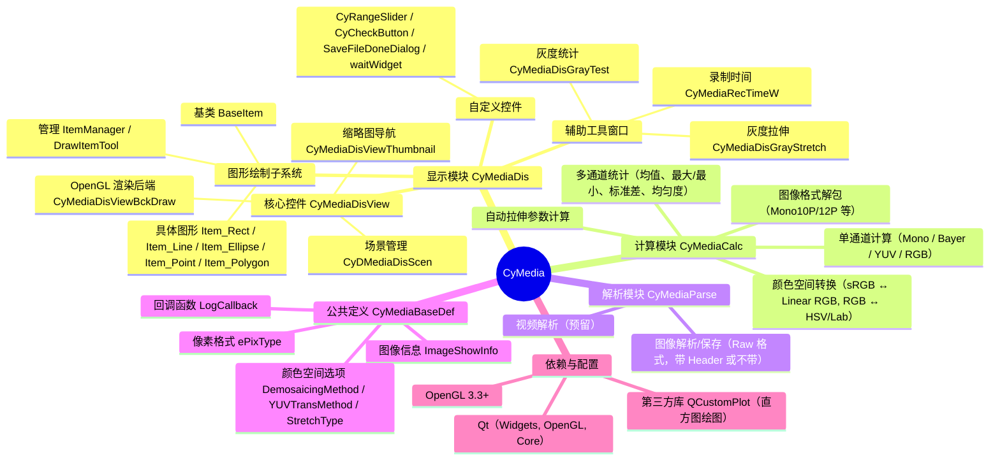

# CyMedia 图像/视频处理与显示库

## 1. 概述
CyMedia 是一个基于 **Qt5.14.2** 和 **OpenGL** 的 C++ 库，主要用于：
- **高性能图像显示**（支持 Mono、Bayer、RGB、RGBA、多种 YUV 格式，8/16/31 位深度）
- **图像计算**（直方图统计、灰度拉伸、颜色空间转换、均匀度等）
- **交互式绘图**（点、线、矩形、椭圆、多边形等 ROI 标注）
- **图像文件解析/保存**（目前支持 Raw 格式，可扩展）
- **视频文件解析**（预留接口，尚未实现）

内部采用 **双缓冲纹理**、**OpenGL 着色器** 实现高效渲染，并提供了灰度拉伸、颜色映射、Bayer 去马赛克、YUV 转换等图像增强功能，适用于**工业相机**、**医疗影像**、**科研采集**等场景。

---

## 2. 总体架构思维导图（Mermaid）




## 3. 模块详解

### 3.1 显示模块 (`CyMediaDis`)

该模块提供完整的图像显示窗口，集成渲染、交互、工具面板。

#### 核心类

| 类名                      | 职责                                                         |
| :------------------------ | :----------------------------------------------------------- |
| `CyMediaDis`              | 主窗口控件（继承 QFrame），包含视图、工具栏、工具面板，对外提供图像更新、缩放、绘制、语言切换等接口。 |
| `CyMediaDisView`          | 基于 `QGraphicsView` 的视图控件，负责显示图像、处理鼠标/键盘交互（缩放、平移、旋转）、管理缩略图。 |
| `CyMediaDisViewBckDraw`   | OpenGL 渲染引擎，管理纹理、着色器、双缓冲，支持多线程异步上传图像数据。 |
| `CyMediaDisViewThumbnail` | 缩略图导航小窗口，显示全景缩略图并标识当前视口位置，支持拖拽定位。 |
| `CyDMediaDisScen`         | `QGraphicsScene` 派生类，提供鼠标位置信号和文件拖放支持。    |

#### 主要功能接口（`CyMediaDis`）

- **图像更新**
  `bool upImageData(ImageShowInfo info, uint8_t* data, bool force)`
  支持多线程调用，内部会转发给渲染后端。
- **灰度拉伸**
  `void setStretchType(StretchType type)`
  `void setStreaChPara(uint32_t start, uint32_t end)`
  支持 Gray / HSV / Lab 三种拉伸方式。
- **Bayer 去马赛克**
  `void setDemosaic(DemosaicingMethod method)`
  可选 None / Bilinear / Malvar / AHD。
- **YUV 转换**
  `void setYUVMethod(YUVTransMethod method)`
  支持标准转换或仅显示 Y 通道。
- **颜色映射**
  `bool setColorMap(const QString& mapName)`
  内置多种伪彩色映射（类似 OpenCV 的 colormap）。
- **绘图标注**
  `QUuid addItem(ItemType type)` 添加图形，`removeItem` 删除，支持点、线、矩形、椭圆、多边形。
  图形可选中、拖拽、调整大小，并发出 `itemDrawed` 等信号。
- **缩略图**
  `void setThumbnailEnable(bool enable)` 控制缩略图是否启用。
- **工具面板**
  内置灰度拉伸控件 (`CyMediaDisGrayStretch`) 和灰度统计控件 (`CyMediaDisGrayTest`)，可独立显示/隐藏。

#### 渲染后端（`CyMediaDisViewBckDraw`）关键点

- 使用 **OpenGL 3.3 Core Profile**，着色器动态编译（根据图像格式选择 variant）。
- 双缓冲纹理（前台/后台）配合 `GLsync` 同步对象，支持子线程更新纹理。
- 支持 **Mono（含 10/12-bit packed）**、**Bayer**、**RGB/RGBA**、**YUV（Packed/Planar/Semi-Planar）**。
- 自动处理 8/16/32 位数据，并转换为浮点纹理或整数纹理。
- 提供 **FPS 统计**（渲染帧率 / 纹理上传帧率）。

#### 图形绘制子系统

- **`BaseItem`**：所有图形项的抽象基类，提供唯一 ID、选择/聚焦、手柄控制、右键菜单框架。
- **具体图形**：`Item_Rect`, `Item_Line`, `Item_Ellipse`, `Item_Point`, `Item_Polygon`，每个实现自己的绘制和交互逻辑。
- **`ItemManager`**：管理所有图形项的增删改查，维护选中状态。
- **`DrawItemTool`**：通过事件过滤器将鼠标事件转发给当前正在绘制的图形项，支持替换模式（绘制新图形自动移除旧图形）。

------

### 3.2 计算模块 (`CyMediaCalc`)

提供图像统计、转换、拉伸参数计算等纯算法功能，不依赖 Qt 界面。

#### 主要函数（命名空间 `CyMediaCalc`）

| 函数                                                         | 功能                                                         |
| :----------------------------------------------------------- | :----------------------------------------------------------- |
| `computeGrayHistogram` / `computeRGBHistogram` / `computeBayerHistogram` / `computerYUVHistogram` | 计算直方图（支持 Mask 过滤）和统计量（均值、最大/最小、标准差、均匀度） |
| `computeGrayStretchPara`                                     | 根据直方图自动计算拉伸起始/结束值                            |
| `bayer2RGB` / `YUV2RGB` / `monoUnPack`                       | 格式转换（Bayer → RGB, YUV → RGB, 10/12-bit packed → 16-bit） |
| `RGBPixel2Strtch` / `RGBT2StretchOneFast`                    | 将 RGB 像素转换为灰度/HSV-V/Lab 亮度值，用于拉伸             |
| `srgb2linear` / `linear2srgb` / `RGBPixel2LAB`               | sRGB ↔ 线性 RGB / Lab 转换                                   |
| `copyAlignImage`                                             | 图像内存对齐复制                                             |

> **注意**：计算模块部分函数支持 `std::vector<uint8_t>` 作为 mask，用于 ROI 统计。

------

### 3.3 解析模块 (`CyMediaParse`)

当前仅实现 `CyMdiaImageParse` 类，负责 Raw 图像的读写。

| 静态方法                 | 说明                                                         |
| :----------------------- | :----------------------------------------------------------- |
| `openImage`              | 打开带 Header 的 Raw 文件（Header 结构见 `RawImageHeadInfo`） |
| `openImage_NotHeaderRaw` | 打开无 Header 的 Raw 文件，需指定宽高、位深、偏移等参数      |
| `saveImageToFile`        | 保存图像数据为 Raw 或 BMP（可添加 Header）                   |
| `getTypeByPath`          | 根据文件扩展名判断图像类型                                   |

未来可扩展支持 TIFF、PNG、JPEG 等（可借助 Qt 的图像读写或第三方库）。

------

### 3.4 公共定义 (`CyMediaBaseDef.h`)

包含所有核心枚举、结构体和回调类型：

- **`ePixType`**：像素格式，涵盖 MONO、BAYER、RGB、RGBA 及多种 YUV FOURCC。
- **`ePixelValueType`**：像素数据类型（整型 / float / double）。
- **`ImageShowInfo`**：描述单帧图像信息（宽高、位深、格式、数据长度），并提供辅助方法判断格式类别、计算行字节数等。
- **`ImageColorOpe`**：包含 Bayer 插值方法、YUV 转换方法、拉伸类型，用于传递颜色处理参数。
- **`DemosaicingMethod`**、**`YUVTransMethod`**、**`StretchType`** 等枚举。
- **`LogCallback`**：日志回调函数类型。

------

### 3.5 自定义控件 (`CyCustomWidget`)

提供几个辅助 UI 控件：

- **`CyRangeSlider`**：双滑块范围选择器，用于灰度拉伸起始/结束值调节。
- **`CyCheckButton`**：开关按钮（类似 iOS 切换开关）。
- **`SaveFileDoneDialog`**：保存成功提示对话框（可自动隐藏）。
- **`waitWidget`**：等待动画对话框（配合 QMovie）。

------

## 4. 使用示例

### 4.1 创建显示窗口并更新图像

cpp

```
#include "CyMediaDis.h"

// 1. 创建显示控件
CyMedia::CyMediaDis* display = new CyMedia::CyMediaDis(parent);

// 2. 设置图像信息（例如 1920x1080 8-bit Mono）
CyMedia::ImageShowInfo info(1920, 1080, 8, CyMedia::MONO);

// 3. 准备图像数据（假设 data 是 uint8_t*，长度为 info.length）
uint8_t* data = ...;

// 4. 上传图像（可在主线程或子线程调用）
display->upImageData(info, data, false);

// 5. 开启灰度拉伸控件
display->setGrayStretchVisible(true);
```


### 4.2 绘制矩形标注并获取选中信号

cpp

```
// 切换到矩形绘制模式
display->setDrawMode(CyDisDrawItem::ItemType::Rectangle);

// 用户绘制完成后，会发出 itemDrawed 信号
connect(display, &CyMedia::CyMediaDis::itemDrawed, [](QUuid id){
    // 获取该图形项
    auto item = display->getItem(id);
    // 可获取其路径或矩形区域
});

// 移除所有图形
display->clearItem();
```


### 4.3 计算直方图

cpp

```
#include "CyMediaCalc.h"

std::vector<double> histogram;
double maxVal, minVal, ave;
CyMediaCalc::computeGrayHistogram(data, info, nullptr, false, 
                                   histogram, &maxVal, &minVal, &ave);

// 自动计算拉伸参数
int32_t start, end;
CyMediaCalc::computeGrayStretchPara(histogram, start, end);
display->setStreaChPara(start, end);
```


------

## 5. 注意事项与最佳实践

1. **OpenGL 共享上下文**
   若在子线程中调用 `upImageData`，必须在初始化 QApplication 前设置：

   cpp

   ```
   QCoreApplication::setAttribute(Qt::AA_ShareOpenGLContexts);
   ```

   

   并在渲染线程中使用 `CyMediaDisViewBckDraw::createSharedContext()` 创建共享上下文。

2. **图像数据生命周期**
   `upImageData` 内部会拷贝数据到纹理，调用后外部数据可立即释放（但需确保调用时数据有效）。

3. **图形绘制**

   - 绘图模式开启后，鼠标操作将用于绘制图形，而不是平移视图（平移需按住 Ctrl 或中键）。
   - 多边形绘制支持连续点击，右键或双击完成绘制。

4. **色彩映射**
   颜色映射文件默认从 `./ColorMaps/` 目录加载（格式为 256×3 字节的 RGB 表）。可通过 `setColorMap` 切换。

5. **性能调优**

   - 对于高分辨率图像，建议启用 OpenGL（默认开启）。
   - 若图像更新频繁，可使用 `setTrueDataFps(true)` 统计真实数据帧率（而非渲染帧率）。

6. **日志回调**
   可通过 `setLogCallback` 注册日志回调，便于调试。

------

## 6. 编译与依赖

- **Qt**: 5.14.2 或更高版本（需包含 Widgets, OpenGL, Core 模块）。
- **OpenGL**: 支持 3.3 Core Profile。
- **编译器**: MSVC 2019+ / GCC 7+ / Clang 10+。
- **第三方**: QCustomPlot（已包含在源码中，用于直方图绘制）。
- **构建**：使用 CMake 或 qmake，需定义 `CYMEDIA_EXPORT` 宏以控制符号导出（Windows DLL）。

------

## 7. 未来扩展

- **视频模块**：`CyMdiaVideo` 预留接口，待实现视频文件解码（可集成 FFmpeg）。
- **更多图像格式**：完善 `CyMediaParse` 支持 TIFF、PNG、JPEG。
- **GPU 加速**：部分计算（如直方图）可迁移至 OpenCL 或 CUDA。